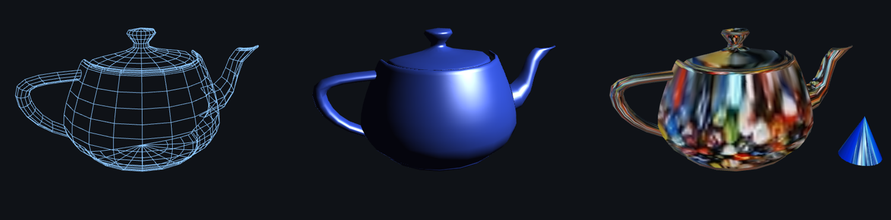

# Teapot Shader

[](https://github.com/Adit12T/Teapot-Shader/actions/workflows/ci.yml)

**Live demo: <https://adit12t.github.io/Teapot-Shader/>**

The Utah teapot built from its 32 Bezier patches and rendered three ways, in the browser with
**WebGL 2**. It's a port of three OpenGL projects I wrote for a computer graphics course in my MS at the
University of South Carolina (2017); the original C/C++ code is kept in [`original/`](original).



## The three modes

| Mode | What it shows | Original project |
|---|---|---|
| **Wireframe patches** | Each patch is a 4×4 grid of control points, evaluated with cubic Bernstein polynomials. Lower the subdivisions to see the patch structure. | Project 1 |
| **Lighting** | Per-pixel Blinn-Phong shading. Pick separate ambient, diffuse and specular colours for the light and the material, the shininess, and a point or distant light, or start from a preset (gold, plastic, clay, pearl). The shaders are Project 2's, ported from GLSL 1.50 to GLSL ES 3.00. | Project 2 |
| **Textures** | Sphere-mapped reflections: each pixel looks up the texture with its reflection vector, as OpenGL's `GL_SPHERE_MAP` did in the original, with a choice of marble, chess-board, chrome and other textures and a textured cone beside the teapot. | Project 3 |

Controls: drag to rotate, shift-drag (or right-drag) to pan, scroll to zoom. With the view focused,
arrow keys rotate, `+`/`-` zoom and `R` resets; `1`, `2` and `3` switch modes.

## How it works

- **Geometry** ([`web/geometry.js`](web/geometry.js)): tessellates each patch into an n×n grid and
  computes normals from the cross product of the two partial derivatives. Where a patch collapses to
  a point (the lid knob and the base) one derivative is zero, so the normal is taken a small step
  inside the patch. Some of the classic patches face inwards, so the shaders light both sides.
- **Rendering** ([`web/app.js`](web/app.js)): three small shader programs, vertex array objects and
  indexed draws; it redraws only when something changes (or while auto-rotating, which is off when
  the system asks for reduced motion).
- **No dependencies**: plain ES modules, no build step, and a strict Content Security Policy
  (`script-src 'self'`).

## Run locally

Any static file server works:

```bash
cd web
python3 -m http.server 8000      # then open http://localhost:8000
npm test                         # geometry and matrix unit tests (Node 22)
```

## The original OpenGL projects

`original/project1-wireframe`, `project2-lighting` and `project3-textures` are the 2017 code. In
Project 2 the keyboard adjusts the red, green and blue of each light and material property; in
Project 3, number keys `1`–`4` switch textures while dragging. To build them on Linux:

```bash
sudo apt-get install build-essential freeglut3-dev libglew-dev libjpeg-dev
cd original/project2-lighting && make && ./runnable
```

The repository used to carry copies of the OpenGL headers, two versions of libjpeg and compiled
binaries; those now come from the system packages above.

## Credits

- Utah teapot geometry: Martin Newell, University of Utah, 1975.
- `original/include` and `InitShader.cpp`: example code for E. Angel and D. Shreiner, *Interactive
  Computer Graphics*, 6th edition (Addison-Wesley, 2012).
- `loadModels.cpp`: adapted from the Wikibooks *Modern OpenGL Tutorial: Load OBJ*.

## License

My code: copyright © 2017–2026 Aditya Tripathi, all rights reserved, published for viewing only.
Third-party material keeps its own terms; see [LICENSE](LICENSE).
